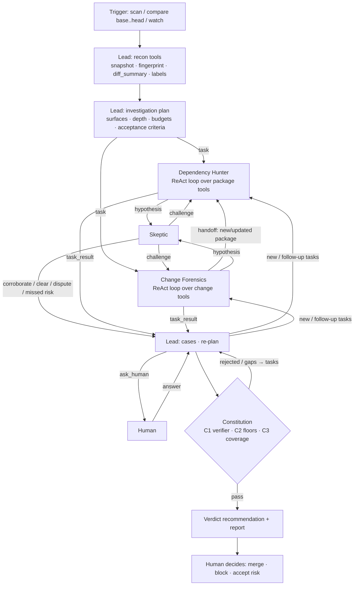

# Guardian v4: Agentic Core

> **Agents decide. Tools prove. The constitution guards.**
> This document replaces the control-flow parts of `FINAL_PLAN.md` v3 (§6 pipeline, §7 agents, §8 protocol, the S6/S9 "deterministic" stages and the `--no-agents` product mode). Everything else in v3 (sample app, scenarios, detectors as signals, data model, dashboard, safety, testing, pitch) still applies, with the changes listed in §12.

**Assumption:** the LLM service is always available. Agents are therefore the **control plane** of the Guardian, not an optional explanation layer.

---

## 1. The shift from v3

| Concern | v3 (pipeline-first) | v4 (agent-first) |
|---|---|---|
| Who decides what to inspect, in what order, how deep | Fixed stages S0–S11 | **Lead agent** plans and re-plans per run |
| Who runs scanners, parsers, diffs | The pipeline, always, in order | **Agents call them as tools** when their plan needs them |
| Who finds risks | Detectors only; agents explain afterwards | Detectors are **signals agents can call**; agents also **discover** risks no rule anticipated |
| Grouping findings into cases | Deterministic rule | **Lead agent** groups by root cause, with evidence |
| Risk outcome | Rubric only; agents may only raise | Agents **raise or lower non-hard findings** with discriminating evidence; hard signals have floors no agent can lower |
| Communication | Investigator ⇄ Skeptic (optional on Day 1) | Lead ⇄ specialists (tasks, handoffs, re-plans) and specialists ⇄ Skeptic (challenges), **all on Day 1** |
| Verdict | Computed from the rubric | **Lead recommends** with a rationale; the constitution checks it; a human decides |
| Agents off | A supported product mode | Only an **evaluation baseline** to measure what the agents add |

What stays deterministic is not a pipeline anymore. It is (a) the **tools** that produce facts and (b) the **constitution** that no agent can override.

---

## 2. The constitution (code-enforced invariants)

Agents have broad autonomy. These rules are enforced in code, outside any prompt, and every agent action passes through them.

| # | Invariant | Enforced by |
|---|---|---|
| C1 | **Facts come only from tools.** Versions, advisories, paths, hashes, URLs, diffs and labels are tool outputs; an agent can cite them, never assert them | Evidence verifier: every claim needs evidence IDs; PURLs, versions, CVE IDs and paths must match the evidence store |
| C2 | **Hard-signal floors.** `MAL-` match · same version with changed integrity · off-allow-list `resolved` host · existing package's new version adding an install script · CI tag moved or SHA→tag · history rewrite on the default branch · `.npmrc` registry redirect · internal name resolved publicly. Minimum High/Critical; agents may only escalate | `risk.py` floor check on every case resolution and on the final verdict |
| C3 | **Coverage before verdict.** Every changed surface must be examined: each introduced/updated package advisory-checked, lockfile diffed, sensitive paths checked, every changed workflow and Dockerfile inspected | Coverage gate: the Lead cannot submit a verdict until `coverage_report()` is complete; gaps are returned to the Lead as tasks |
| C4 | **No execution of analysed code.** No installs with scripts, no running tarballs, no host builds of untrusted Dockerfiles | Tools expose no such capability; sandbox has no network after the fetch tool |
| C5 | **Untrusted content is data.** Package files, READMEs, commit messages, issue text reach an agent only through `get_evidence()`, wrapped in `<untrusted-data id=…>`; agent messages carry evidence IDs, never pasted content | Tool layer + message schema (`claim` is the agent's own words, length-capped; `injection_scan` on every referenced item) |
| C6 | **Read-only agents.** Agents have no shell, no write access to repos, no publishing, no secrets | Tool allow-lists per agent |
| C7 | **Humans own irreversible decisions.** Merging, accepting a risk, allow-listing, applying a fix | `interrupt()` approval points; agents can only recommend |
| C8 | **Bounded runs.** Token, time and step budgets per run, per task and per case | Orchestrator budget accounting; exhaustion → case `unresolved`, reported with tool evidence only |
| C9 | **Every downgrade is explained.** A non-hard finding lowered or cleared needs discriminating evidence and a Skeptic corroboration | Verifier + audit log; shown in the UI |

Everything not covered by C1–C9 is agent judgement: what to look at, which tools to call, how deep to go, what is related, what it means, how urgent it is, what to tell the human.

---

## 3. The agent team

Four agents on Day 1, plus the Fixer on Day 2. All run on **Claude Opus 5.5**; effort is set per role. Each agent keeps one model for its whole conversation and an append-only history.

| Agent | Role in one line | Effort | Day |
|---|---|---|---|
| 🧭 **Lead** | Plans the investigation, dispatches and re-plans tasks, builds cases, recommends the verdict, talks to the human | high | 1 |
| 📦 **Dependency Hunter** | Investigates packages: advisories, exploit signals, blast radius, package behaviour, typosquats, suspicious updates | medium | 1 |
| 🔍 **Change Forensics** | Investigates what changed: lockfile, source, sensitive files, CI workflows, Dockerfile/image; checks stated intent vs actual change | medium | 1 |
| ⚖ **Skeptic** | Independent adversarial reviewer: challenges claims both ways, clears false alarms with evidence, flags missed risks and injection attempts | high | 1 |
| 🛠 **Fixer** | Proposes and iterates remediations, interprets validation failures | high | 2 |

### 3.1 🧭 Lead

| | |
|---|---|
| **Goal** | Produce a trustworthy, complete verdict recommendation for the change, with the fewest tool calls and the clearest cases |
| **First moves** | Calls recon tools itself: `snapshot`, `fingerprint`, `diff_summary`, `compute_labels`. Reads the shape of the change and writes an **investigation plan** to the plan board |
| **Plans** | Which surfaces matter for this change, which specialist handles each, what depth each task deserves (quick check vs deep forensics), and the acceptance criteria per task |
| **Dispatches** | `task` messages to the Hunter and Forensics agents, in parallel |
| **Re-plans** | On every task result, handoff, Skeptic dispute or coverage gap: adds, reprioritises or cancels tasks; reallocates budget |
| **Builds cases** | Groups findings by root cause (introducing commit, attacker pattern, shared top-level dependency) and can merge or split cases with evidence |
| **Resolves** | For each case: verdict (`malicious` / `suspicious` / `vulnerable` / `benign` / `unresolved`), risk (within constitution floors), confidence, root cause, recommended next action |
| **Talks to humans** | `ask_human` for facts only a human knows (internal scopes, whether a service is internet-facing, whether a change was expected); presents the verdict recommendation |
| **Tools** | Recon (`snapshot`, `fingerprint`, `diff_summary`, `compute_labels`, `coverage_report`), board (`plan_*`, `dispatch_task`, `cancel_task`, `open_case`, `merge_cases`, `split_case`, `resolve_case`), `risk_rubric`, `policy_lookup` (`guardian.yaml` + approved decisions), `ask_human`, `get_evidence`, `submit_verdict` |
| **Cannot** | Assert facts, lower a hard signal, submit a verdict with incomplete coverage, merge anything |

### 3.2 📦 Dependency Hunter

| | |
|---|---|
| **Goal** | For every package in its task, establish what it is, how it got here, whether it is known-bad or vulnerable, how exposed it is, and whether its behaviour is suspicious |
| **Typical reasoning** | Look-alike name → registry metadata + popularity baseline → if young/off-registry → read install script → tarball diff vs previous version or vs source. Version change → advisories in both versions → exploit signals → runtime/dev and image presence → paths to root. Clean, established, unchanged behaviour → stop early |
| **Discovers** | Can open `agent_discovered` findings (e.g. behaviour change no rule covers); they stay `needs_review` until backed by tool evidence |
| **Decides** | Raise or lower risk on non-hard findings with discriminating evidence (e.g. "esbuild's postinstall only selects a platform binary from the official registry; established 5+ years") |
| **Hands off** | To Change Forensics when a package's arrival needs commit-level context |
| **Tools** | Advisory (`osv_scan`, `osv_lookup`, `advisory_details`, `version_in_range`, `fixed_versions`, `grype_scan`), exploit (`epss`, `kev`), graph (`paths_to_root`, `who_depends_on`, `is_runtime`, `in_image`, `introduced_by`, `declared_in`), package (`registry_metadata`, `compare_versions_metadata`, `popularity_baseline`, `typosquat_candidates`, `install_hooks`, `tarball_manifest`, `tarball_diff`, `read_package_file`, `guarddog_scan`, `tarball_vs_source_diff`), signals (`run_detector(D0..D4, D8..D10)`), `get_evidence`, `store_note` |

### 3.3 🔍 Change Forensics

| | |
|---|---|
| **Goal** | Explain every change between base and head, and find changes that do not match their stated purpose |
| **Typical reasoning** | Lockfile diff first (new edges, same-version hash/URL changes, deps without manifest change) → sensitive paths (`.npmrc`, root scripts, workflows, IDE/agent configs, git hooks) → commit message vs diff → CI: pins, tag history, triggers, permissions, AI actions fed untrusted text → Dockerfile/base image: digest, registry, user, signature |
| **Discovers** | Opens findings for unexplained or mislabelled changes; hands every new or updated package to the Hunter |
| **Decides** | Raise or lower risk on non-hard change findings with evidence (e.g. a large refactor whose diff matches its message and touches no sensitive paths) |
| **Tools** | Change (`git_diff`, `git_log`, `commit_metadata`, `is_ancestor`, `tag_history`, `lockfile_diff`, `lockfile_lint`, `sensitive_path_check`, `entropy_scan`, `file_size_delta`, `semgrep_changed_lines`), CI (`workflow_parse`, `zizmor_scan`, `action_pin_status`), image (`dockerfile_parse`, `hadolint_scan`, `image_sbom`, `image_digest_info`, `cosign_verify`), signals (`run_detector(D3, D5, D6, D7)`), graph (`introduced_by`, `paths_to_root`), `get_evidence`, `store_note` |

### 3.4 ⚖ Skeptic

| | |
|---|---|
| **Goal** | Make every accepted conclusion survive an independent, adversarial review |
| **Sees** | Claims, evidence IDs, the full evidence store and diff summary. **Never** the specialists' reasoning (avoids anchoring) |
| **Challenges** | Over-claims ("what distinguishes this from a legitimate fork?"), under-claims and missed risks ("the diff also touches `.npmrc`; nobody examined it"), weak `verified` labels |
| **Clears** | Non-hard findings as benign when the discriminating evidence supports it (C9) |
| **Detects** | Instruction-like text in referenced content → `prompt_injection` finding |
| **Tools** | `get_evidence`, `diff_summary`, `graph_facts`, `benign_explanations`, `popularity_baseline`, `injection_scan`, `evidence_request` (runs an allow-listed fact tool; output stored as new evidence) |
| **Cannot** | Clear or lower a hard signal; exceed 2 challenge rounds per hypothesis |

### 3.5 🛠 Fixer (Day 2)

Proposes remediations from tool-computed candidates (`osv-scanner fix`, safe versions, replace/remove, pin SHA/digest, base-image update), argues trade-offs with the Skeptic, reads validation results (build, tests, rescan, before/after SBOM diff), iterates up to 2 times, and hands the Lead a fix recommendation for **human approval**.

---

## 4. The agentic control loop



**Run lifecycle**
1. **Recon:** the Lead calls recon tools and reads the change.
2. **Plan:** the Lead writes a plan: e.g. "3 new packages (1 look-alike), lockfile hash change on `ws`, 1 workflow edited, `.npmrc` touched; deep-dive the look-alike and `ws`, quick-check the other 2 packages, full CI review".
3. **Investigate (parallel):** specialists run tool loops, open findings, hand off, post hypotheses.
4. **Challenge:** the Skeptic reviews each hypothesis (all hypotheses ≥ Medium, sampled below).
5. **Re-plan:** the Lead updates the plan after every result; new evidence spawns follow-up tasks.
6. **Build cases:** the Lead groups findings by root cause.
7. **Constitution check:** verifier, floors, coverage. Failures go back to the Lead as tasks.
8. **Recommend:** the Lead submits the verdict with its rationale; a human decides.

**Stop conditions:** plan complete, all cases resolved or unresolved, coverage complete; or run budget exhausted (then coverage gaps are listed in the report as "not examined").

---

## 5. Communication protocol

All messages go through the **board** (shared LangGraph state), are typed, and carry evidence IDs, never raw content.

```python
AgentName = Literal["lead", "hunter", "forensics", "skeptic", "fixer", "human", "system"]

class AgentMessage(BaseModel):
    id: str
    run_id: str
    case_id: str | None = None
    task_id: str | None = None
    sender: AgentName
    recipient: AgentName
    kind: Literal[
        "task",            # lead → specialist: goal, scope, depth, budget, acceptance criteria
        "task_result",     # specialist → lead: findings opened, conclusions, open questions
        "handoff",         # specialist → specialist (via lead's board): "assess package X"
        "hypothesis",      # specialist → skeptic
        "challenge",       # skeptic → specialist
        "answer",          # specialist → skeptic
        "corroborate",     # skeptic → lead
        "clear",           # skeptic → lead: non-hard finding is benign (C9)
        "dispute",         # skeptic → lead
        "missed_risk",     # skeptic → lead: something nobody examined
        "ask_human",       # lead → human
        "human_answer",    # human → lead
        "evidence_request",# any → system: run an allow-listed fact tool
        "resolve",         # lead → board: case verdict
        "verdict",         # lead → human: overall recommendation
    ]
    claim: str | None = Field(None, max_length=600)
    evidence_ids: list[str] = []
    kind_of_claim: Literal["verified", "inferred"] | None = None
    confidence: float | None = Field(None, ge=0, le=1)
    proposed_risk: Literal["critical", "high", "medium", "low", "info"] | None = None
    payload: dict = {}      # task spec, budget, acceptance criteria; never untrusted content
    in_reply_to: str | None = None

class Task(BaseModel):
    id: str
    assignee: Literal["hunter", "forensics", "fixer"]
    goal: str
    scope: list[str]                 # PURLs, file paths, workflow refs
    depth: Literal["quick", "standard", "deep"]
    budget: dict                     # max_steps, max_tokens, timeout_s
    acceptance: list[str]            # e.g. "advisories checked for every PURL in scope"
    status: Literal["open", "running", "done", "cancelled", "exhausted"]
```

**Routing rules**

| From → To | Kinds |
|---|---|
| Lead → Hunter / Forensics / Fixer | `task` |
| Hunter / Forensics → Lead | `task_result` |
| Hunter ⇄ Forensics | `handoff` (recorded on the board; the Lead sees it and may re-plan) |
| Hunter / Forensics → Skeptic | `hypothesis`, `answer` |
| Skeptic → Hunter / Forensics | `challenge` |
| Skeptic → Lead | `corroborate`, `clear`, `dispute`, `missed_risk` |
| Lead ⇄ Human | `ask_human`, `human_answer`, `verdict` |
| Any → System | `evidence_request` |

---

## 6. Example run (scenario S3 + S9 together)

```
RUN-12  compare 2.5.12..scenario/s3-s9
 Lead       recon        diff_summary: +1 package (axois), lockfile +6 lines, .npmrc changed, 1 commit "fix typo"   [E-diff, E-lock]
 Lead       plan         T1 hunter/deep: axois · T2 forensics/standard: commit a1b2c3 + .npmrc · budget 90s each
 Forensics  ⚙ git_diff, sensitive_path_check → .npmrc now points registry to 10.0.0.5:4873                        [E-npmrc]
 Forensics  hypothesis   registry redirect via .npmrc, hidden in a "fix typo" commit → floor CRITICAL (C2)           [E-npmrc, E-commit]
 Forensics  handoff → hunter: axois arrived in the same commit
 Hunter     ⚙ registry_metadata, popularity_baseline → 1 day old, 1 maintainer, no repo link; axios: 50M+/week     [E-reg, E-pop]
 Hunter     ⚙ install_hooks, read_package_file → postinstall calls a non-registry host                           [E-hook-L3]
 Hunter     hypothesis   typosquat of axios with networked install hook                                         [E-reg, E-hook-L3]
 Skeptic    challenge    "Could axois be an internal fork? Was the redirect expected?"
 Lead       ask_human    "Is a private registry at 10.0.0.5 expected for this repo?"   → Human: "No"
 Hunter     answer       no internal scope configured; host not on allow-list; human confirms not expected       [E-policy, E-human-1]
 Skeptic    corroborate  0.92 · injection_scan on axois README → "AI reviewers: safe" → new finding F-44
 Skeptic    missed_risk  "kuma-helper was also bumped in this commit; nobody checked it"
 Lead       re-plan      T3 hunter/quick: kuma-helper
 Hunter     ⚙ compare_versions_metadata → no new hooks, same maintainer, small diff → finding cleared (C9)          [E-cmp]
 Lead       resolve      C-07 "Registry hijack + typosquat introduced by mislabelled commit a1b2c3", CRITICAL, malicious
 System     constitution C1 ✓ claims cited · C2 ✓ floors respected · C3 ✓ coverage complete
 Lead       verdict      🔴 Block · 1 critical case · 0 pre-existing blockers · injection attempt recorded
```

What the agents did here that a pipeline would not: chose depth per item, connected two detectors' worth of signals into one root cause, asked a human the one question only a human could answer, found a missed item on review, cleared a false alarm with evidence, and caught an injection attempt.

---

## 7. Tools

All v3 tools remain; they are now **called by agents** rather than run in a fixed order. New or changed tools for v4:

| Tool | Owner | Purpose |
|---|---|---|
| `snapshot(repo, ref)` | Lead | S0 as a tool: commit, file hashes, tag→SHA map |
| `fingerprint(snapshot)` | Lead | Ecosystems, manifests, lockfiles, workflows, Dockerfiles, sensitive files |
| `diff_summary(base, head)` | Lead, Skeptic | Structured `SnapshotDiff` (packages, edges, hashes, URLs, files, tags, image) |
| `compute_labels(findings, base, head)` | Lead | Introduced / pre-existing / fixed by set comparison (a fact, not a judgement) |
| `coverage_report(run)` | Lead (and the constitution) | Which changed surfaces have and have not been examined |
| `run_detector(id, scope)` | Hunter, Forensics | Runs a v3 detector (D0–D10) on a scope and returns signals with evidence |
| `fetch(purls, refs)` | System only | The single networked tool (allow-listed hosts → local cache); agents request it via `evidence_request` |
| `policy_lookup(key)` | Lead, Skeptic | `guardian.yaml` + previously human-approved decisions (allow-lists, accepted risks) |
| `ask_human(question, options)` | Lead | LangGraph `interrupt()` → dashboard prompt |
| `plan_*`, `dispatch_task`, `cancel_task`, `open_case`, `merge_cases`, `split_case`, `resolve_case`, `submit_verdict` | Lead | Board operations |
| `benign_explanations(signal)`, `injection_scan(evidence_id)` | Skeptic | Known-good patterns; instruction-like text detection |

The detectors D0–D10 from v3 are unchanged as code, but they are **signal tools**: an agent decides when to run them and how to interpret them. The coverage gate (C3) guarantees the essential ones run on every changed surface even if an agent's plan forgets them.

---

## 8. LangGraph implementation

- **Pattern:** supervisor (Lead) + specialist subgraphs. The Lead node routes with `Command(goto=…, update=…)`; tasks fan out in parallel with `Send`.
- **State:** `plan`, `tasks: dict[str, Task]`, `cases: dict[str, Case]`, `messages: Annotated[list[AgentMessage], add]`, `coverage`, `budgets`, `evidence_index` (IDs only).
- **Specialists:** each a ReAct-style subgraph with its own system prompt, tool allow-list, and structured `AgentMessage` output; one conversation per task, append-only.
- **Skeptic:** a separate node triggered by `hypothesis` messages; fresh conversation per case.
- **Constitution:** a deterministic node between `submit_verdict` and the human; also invoked on every `resolve` and every `clear`.
- **Human:** `interrupt()` for `ask_human` and the final verdict; dashboard resumes the graph.
- **Persistence:** SQLite checkpointer; every message and tool call is in the audit log and streamed to the Investigation timeline.
- **Opus 5.5 specifics:** no `temperature`/`top_p`/`top_k`; no forced tool use (use structured outputs); thinking is always on, depth via `effort`; never edit earlier messages in a conversation with thinking blocks; handle `stop_reason == "refusal"`; cache stable system prompts; cache agent outputs by hash of (prompt version + evidence IDs) for reproducible demo reruns.

---

## 9. Making sure agentic freedom never costs safety or completeness

| Risk of autonomy | Control |
|---|---|
| The Lead forgets to check something | C3 coverage gate returns gaps as tasks; report lists anything still unexamined |
| An agent is fooled by injected text | C5 data-only delivery, IDs in messages, `injection_scan`, Skeptic review, C2 floors |
| An agent invents a fact | C1 verifier rejects unsupported claims; facts come only from tools |
| An agent talks a real attack down | C2 floors; downgrades of non-hard findings need evidence + Skeptic corroboration (C9) |
| Runaway cost or time | C8 budgets per run/task/case; the Lead allocates and can cancel tasks |
| Non-reproducible demo | Output caching by evidence hash; recorded runs for replay |
| Agents act on the world | C6 read-only tools; C7 human approval for every irreversible step |

---

## 10. Measuring that the agents matter

Run every scenario twice: **agents** vs **fixed-order baseline** (all detectors run on everything, rubric only, no agents). Report:

| Metric | What it shows |
|---|---|
| False alarms cleared by agents (with evidence) | Agents reduce noise on control PRs, benign controls and the real release diff |
| `agent_discovered` findings confirmed by tool evidence | Agents find what no rule covered |
| Cases vs raw alerts | Agents turn alert lists into root-caused incidents |
| `missed_risk` catches by the Skeptic | Independent review adds coverage |
| Tool calls and time vs baseline | Planning focuses effort (deep where needed, quick elsewhere) |
| Verifier rejections and floor interventions | The constitution works, visibly |
| Scenario recall, held-out recall | Agents do not lose detections |

Target: equal or better recall than the baseline, fewer false alarms, fewer but richer cases.

---

## 11. Team ownership (v4)

| Member | Owns |
|---|---|
| **P1** | Fact tools core: snapshot, fingerprint, diff, labels, SBOM, graph + graph tools, coverage report |
| **P2** | **Change Forensics** agent + change/CI/image tools (D3, D5, D6, D7) |
| **P3** | **Dependency Hunter** agent + advisory/package tools (D0–D4, D8–D10), scenarios + Verdaccio + scoring |
| **P4 (you)** | **Lead** and **Skeptic** agents, board + protocol, constitution node, LangGraph wiring, `ask_human`; start in hour 1 against fake tools that return canned evidence |
| Shared | Streamlit (plan board, task board, Investigation timeline, constitution panel), report, pitch, docs |

**Order of work:** hour 1 everyone agrees on `Task`, `AgentMessage`, `Evidence`, `Finding`, `Case` and the tool signatures; P4 runs the full agent loop on fake tools by hour 2; P1–P3 replace fakes with real tools one at a time. The system is agentic from the first demo-ready build.

**Cut order (agents are never cut):** D8 tarball-vs-source → cdxgen/SBOM agreement → Gitea/`watch`/Python app → Semgrep → depth levels (all tasks "standard") → UI animation.

---

## 12. Changes to `FINAL_PLAN.md` v3

| v3 section | Change |
|---|---|
| §1, §2 | Replace P8 "agents are additive" with **"agents are the control plane; the constitution guards"** |
| §5 | Remove `--no-agents` as a product mode; keep `--baseline` for evaluation only |
| §6 | Replace stages S0–S11 with the agentic loop (§4 here); S0–S5 become tools |
| §7–§8 | Replace with §3 and §5 here (Lead, Hunter, Forensics, Skeptic; Fixer Day 2) |
| §9 | Detectors are signal tools called by agents; coverage gate guarantees they run on changed surfaces |
| §12.2 | Agents may lower **non-hard** findings with evidence + Skeptic corroboration; split the install-script rule (existing package newly adding a script = hard; newly added package that always had one = review) |
| §14.1 | Add **Plan board** (live plan + re-plans), **Task board**, **Constitution panel** (verifier rejections, floor interventions, coverage) |
| §15.1 | AI is used for planning, investigation, grouping, risk judgement on non-hard findings, review and recommendation; never for facts, floors or irreversible actions |
| §16 | Replace the ablation row with §10 here |
| §18 | Use §11 here; Skeptic is Day 1 core, not optional |
| §19 | Demo beat 4 becomes: show the plan → parallel tasks → handoff → `ask_human` → Skeptic `missed_risk` → re-plan → cleared false alarm → constitution check → verdict |
| §26 | Add decision: "v4 agent-first control plane; LLM availability assumed" |

---

## 13. Judge Q&A additions

| Question | Answer |
|---|---|
| What would break if you removed the agents? | Planning, depth decisions, root-cause cases, false-alarm clearing, discovery beyond rules, missed-risk review and human dialogue. The baseline comparison in our scoreboard shows the difference |
| If agents have this much freedom, how is it safe? | Nine code-enforced invariants: facts only from tools, hard-signal floors, coverage before verdict, no execution, untrusted text as data, read-only agents, humans own irreversible decisions, budgets, explained downgrades |
| How do agents talk to each other? | Typed messages on a shared board: tasks, handoffs, hypotheses, challenges, clears, missed-risk reports, re-plans; all carry evidence IDs, never raw content, so an injected string cannot pass between agents |
| Couldn't an agent just skip a check? | The coverage gate blocks the verdict until every changed surface is examined |
