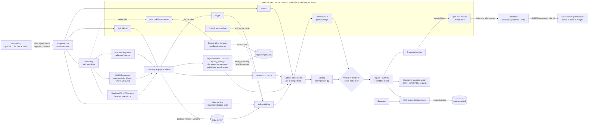
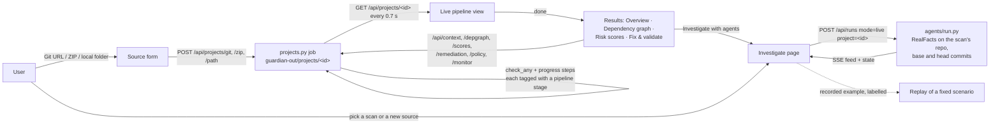

# Architecture

> Status: this file covers the **deterministic pipeline** (scan, registry checks, reachability, scoring, policy-as-code, remediation, monitoring) **and its sandbox**. The agent layer
> (Lead, Dependency Hunter, Change Forensics, Skeptic, constitution) is described in `docs/AGENTIC_CORE.md`, and
> risk scoring in `docs/SCORING.md`.

## Scan pipeline (`guardian scan` / `guardian check` / the dashboard's Scan page)

All three entry points run `guardian/universal.py:check_any`. It is deterministic: no LLM is involved in any number
or label.

### Human approval points
| Action | Who decides | How |
|---|---|---|
| Merge / block | Human reviewer | Guardian gives a verdict (block / review / allow) and evidence; it never merges |
| Triage a finding | Human reviewer | Confirm, challenge, or defer against specific evidence. The [review timeline](HUMAN_FEEDBACK.md) follows the finding across scans. |
| Apply a fix | Human reviewer | "Fix & validate" → Validate (sandbox, no repo change) → name + confirmation → **Approve & create branch** (local only) |
| Push / open a PR | Human | Guardian prints the commands; it never pushes (CLAUDE.md §3.1: draft PRs on our fork at most) |
| Policy, trusted images, allow-lists | Human (repo owner) | `guardian.yaml` and `policies/*.rego`, reviewed like code |

### Trust boundaries

The investigation's mandatory checks, model evidence boundary, validated tool calls, and reviewer context
are documented in [Guardian self-protection](GUARDIAN_SELF_PROTECTION.md).

| Runs where | What | Why it is safe |
|---|---|---|
| Host (Guardian's own code) | git (read objects only, hooks disabled), Python parsers, OSV/EPSS/KEV lookups, npm registry metadata and tarballs (fetch hosts only, tarballs read in memory, never extracted or run), egress proxy, scoring, branch creation after approval (git plumbing, no checkout) | Guardian code only; repository and package content is read as data, never executed |
| Sandbox container | npm resolution and fix application, Syft, Grype, OSV-Scanner, zizmor, Conftest | These are third-party parsers fed attacker-controlled files, and package managers read config from the folder (a repository `.npmrc` could make `npm --ignore-scripts` run a program; regression test in `tests/test_sandbox.py`) |
| Nowhere | Building, installing or running the analysed project | Out of scope by design (CLAUDE.md §3.2) |

Each sandboxed run is recorded: tool, pinned image, duration, exit code, error, and refused hosts. The records are
in `<snapshot>/sandbox.json` and summarised in `headline.sandbox`. A tool that could not run becomes a
`tool_error` finding with the label `not_checked`. It is never scored and is shown in the Day 1 view as
"NOT checked".

### Ecosystem coverage

| Ecosystem | Components from | Static checks |
|---|---|---|
| npm | Guardian lockfile parser (exact graph = `npm ls`); lockfile resolved in the sandbox if missing | D1-D7, D11, D14, D16 |
| Python (pip, poetry, uv, pipenv) | Syft | D4 index/registry config, D13 undeclared imports, D19 `--trusted-host` / plain HTTP |
| Go | Syft (go.mod / go.sum) | D18 `replace`, missing go.sum, checksum switches (GOSUMDB=off, GOINSECURE, GOFLAGS=-insecure, GONOSUMDB) |
| Java Maven | Syft (pom.xml) | D17 wrapper checksum, D19 plain-HTTP / extra repositories, version ranges |
| Java Gradle | Guardian build.gradle(.kts) reader; Syft for gradle.lockfile | D17, D19 (incl. `1.+` / `latest.release`) |
| C/C++ | Guardian readers: vcpkg.json, conanfile.txt, CMake FetchContent/ExternalProject, meson wraps, submodules | D15 unpinned / unverified source fetches, D19 |
| .NET | Guardian reader for `Directory.Packages.props` / project files; Syft for `packages.lock.json` | D19 floating versions, extra/HTTP NuGet feeds |
| Rust, Ruby, PHP | Syft (`Cargo.lock`, `Gemfile.lock`, `composer.lock`) | vulnerabilities; CI/images; remediation commands (manual) |
| Others Syft knows (Swift, Dart, Elixir …) | Syft | vulnerabilities only |

Details of each detector: `docs/DETECTORS.md`. Gaps: `docs/KNOWN_LIMITATIONS.md`.

## Dashboard (`guardian/server.py` + `guardian/dashboard`)

Two pages, both driven by the same deterministic report; nothing about the sample app is built in.

- **Sources.** A Git URL is cloned read-only (https, host allow-list, no checkout, no hooks, no submodules). A ZIP is
  extracted with path, symlink, size and file-count checks. A **local folder** must be inside `GUARDIAN_PATH_ROOTS` (default:
  the user's home directory; the home directory itself and Guardian's own output are refused). A Git repository is cloned
  into the project folder, its branches copied as local branches, and the original never written to. Any other folder is
  copied like a ZIP (regular files only; no symlinks, `node_modules` or `.git`).
- **Progress.** `projects.stage_of` maps each pipeline message to one of eight stages (fetch, inventory, sbom, ci, vulns,
  compare, registry, policy). The stage only moves forward, so the base-version rescan stays in "compare". A stage with no
  message is shown as not needed.
- **Agents on any scan.** `POST /api/runs` with `mode=live` and a project ID investigates the saved scan and the recorded
  base and head commits. The scan provides inventory and findings across all ecosystems. Required checks run before any model
  call; if the model fails (for example an invalid key) the run records the reason and the verdict falls back to the
  hard-signal rule. A project without a root `package-lock.json` has no npm packages for the package tools; commits,
  changed and sensitive files are still investigated. `mode=replay` plays the recorded example and is labelled as such.
- **Links.** Hash routes (`#/scan/<id>/<view>`, `#/investigate/<id>`) make every scan and investigation reloadable.
  `main` is the report of the latest `guardian check` on the command line.
