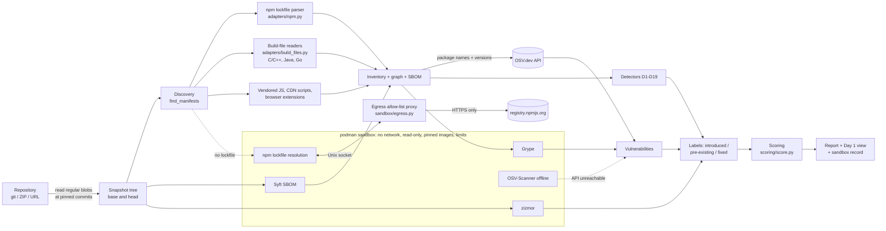

# Architecture

> Status: this file currently covers the **deterministic scan pipeline and its sandbox**. The agent layer
> (Lead, Dependency Hunter, Change Forensics, Skeptic, constitution) is described in `docs/AGENTIC_CORE.md`, and
> risk scoring in `docs/SCORING.md`.

## Scan pipeline (`guardian scan` / `guardian check` / "Scan a project")

All three entry points run `guardian/universal.py:check_any`. It is deterministic: no LLM is involved in any number
or label.

### Trust boundaries

The investigation's mandatory checks, model evidence boundary, validated tool calls, and reviewer context
are documented in [Guardian self-protection](GUARDIAN_SELF_PROTECTION.md).

| Runs where | What | Why it is safe |
|---|---|---|
| Host (Guardian's own code) | git (read objects only, hooks disabled), Python parsers, OSV/EPSS/KEV lookups, egress proxy, scoring | Guardian code only; repository content is read as text, never executed |
| Sandbox container | npm resolution, Syft, Grype, OSV-Scanner, zizmor | These are third-party parsers fed attacker-controlled files, and package managers read config from the folder (a repository `.npmrc` could make `npm --ignore-scripts` run a program; regression test in `tests/test_sandbox.py`) |
| Nowhere | Building, installing or running the analysed project | Out of scope by design (CLAUDE.md §3.2) |

Each sandboxed run is recorded: tool, pinned image, duration, exit code, error, and refused hosts. The records are
in `<snapshot>/sandbox.json` and summarised in `headline.sandbox`. A tool that could not run becomes a
`tool_error` finding with the label `not_checked`. It is never scored and is shown in the Day 1 view as
"NOT checked".

### Ecosystem coverage

| Ecosystem | Components from | Static checks |
|---|---|---|
| npm | Guardian lockfile parser (exact graph = `npm ls`); lockfile resolved in the sandbox if missing | D1-D7, D11, D14, D16 |
| Python (pip, poetry, uv, pipenv) | Syft | D4 index/registry config, D13 undeclared imports, D19 `--trusted-host` / plain HTTP |
| Go | Syft (go.mod / go.sum) | D18 `replace`, missing go.sum, checksum switches (GOSUMDB=off, GOINSECURE, GOFLAGS=-insecure, GONOSUMDB) |
| Java Maven | Syft (pom.xml) | D17 wrapper checksum, D19 plain-HTTP / extra repositories, version ranges |
| Java Gradle | Guardian build.gradle(.kts) reader; Syft for gradle.lockfile | D17, D19 (incl. `1.+` / `latest.release`) |
| C/C++ | Guardian readers: vcpkg.json, conanfile.txt, CMake FetchContent/ExternalProject, meson wraps, submodules | D15 unpinned / unverified source fetches, D19 |
| Others Syft knows (Rust, Ruby, PHP, .NET, Swift, Dart, Elixir) | Syft | vulnerabilities only |

Details of each detector: `docs/DETECTORS.md`. Gaps: `docs/KNOWN_LIMITATIONS.md`.
