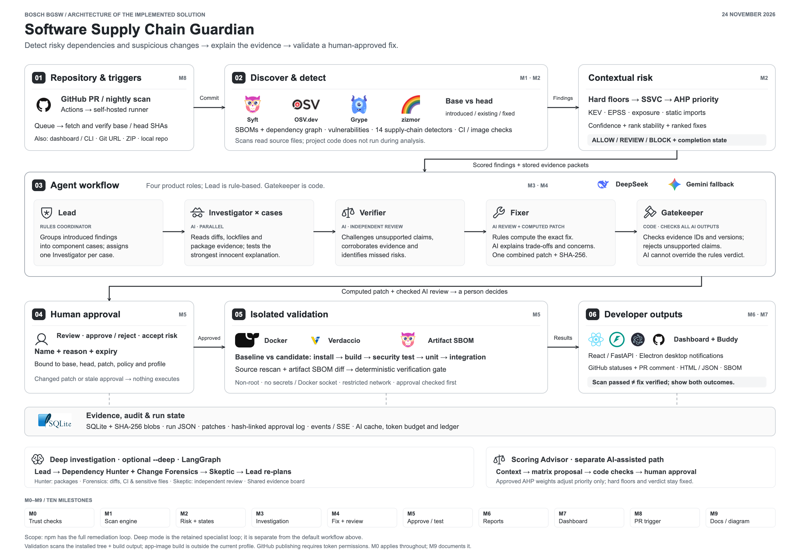

# Architecture

## Visual architecture (24 November 2026)



[Editable SVG](architecture/guardian-architecture.svg) · [PNG](architecture/guardian-architecture.png) · [Local preview](architecture/guardian-architecture.html) · [Official logo sources](architecture/assets/sources.json) · [Rebuild script](architecture/build_diagram.py)

The visual follows the current implementation, including provider selection in `guardian/llm_client.py` (DeepSeek direct, FreeModel, configurable Gemini fallback), the default fixed AI workflow, the separately labelled optional deep agent loop, and the current validation profile. M0–M9 comprises ten milestones. It maps architecture coverage, not milestone completion or a claim that every deployment has passed live validation.

| Diagram block | Implementation evidence |
|---|---|
| 1. Repository & triggers | `ci/github/guardian.yml`, `guardian/trigger/{submit,queue,service,watcher}.py`, `guardian/server.py`, `guardian/dashboard/` |
| 2. Discover, detect & score | `guardian/universal.py`, `guardian/inventory/ci_risk.py`, `guardian/check.py`, `guardian/scoring/{score,verdict,states,confidence}.py`, `guardian/scoring/contextual/` |
| 3. Agent workflow, including computed fix + AI review | `guardian/ai/{packet,workflow}.py`, `guardian/llm_client.py`, `guardian/llm_budget.py`, `guardian/remediation/{candidates,plan,patch,review}.py`, `guardian/server.py::_fixer` |
| 4. Human approval | `guardian/approval.py`, `guardian/server.py` approval/risk-acceptance endpoints |
| 5. Validate in isolation | `guardian/validation/{validate,runner}.py`, `guardian/validation/profiles/uptime-kuma/{profile.yaml,integration.cjs}` |
| 6. Developer outputs | `guardian/report/build.py`, `guardian/dashboard/src/run/`, `guardian/trigger/github.py`, `buddy/{main,pet}.js` |
| Shared evidence & audit | `guardian/store/evidence.py`, `guardian/approval.py`, `guardian/trigger/events.py`, `guardian/llm_budget.py` |
| Optional deep investigation | `guardian/cli.py` (`--deep`), `guardian/agents/{run,orchestrator,agents,tools,constitution}.py` |
| Scoring Advisor | `guardian/scoring/{advisor,ahp_api,ahp_context}.py`, `guardian/agents/prompts/scoring_advisor.md` |

### Agent roles and reconciliation of the documents

Guardian detects both known vulnerabilities and suspicious non-CVE supply-chain changes, then connects evidence to remediation and independently validated results. Its agent diagrams changed as the project developed. `FINAL_PLAN.md` and `AGENTIC_CORE.md` describe the earlier investigation design. `GUARDIAN_FINAL_PLAN.md` §11 and `PRODUCT_PLAN.md` §4 define the four product roles. The later **M3 (redone)** and **M7 (redone)** entries in `PROGRESS.md`, `RESPONSIBLE_AI.md`, `LIVE_DEMO_PLAN.md`, the contextual-scoring integration note and executable code determine which path is current. Old model names, budgets, replica counts and statements about autonomous verdicts are not combined into one architecture.

| Current role | Responsibility | Implementation distinction |
|---|---|---|
| Lead | Group introduced findings by component and assign a case to an Investigator | Rules, not an LLM call in the default workflow (`ai/packet.py`, `ai/workflow.py`) |
| Investigator × cases | Assess the evidence, test innocent explanations and list open questions | Parallel read-only AI calls over pre-collected evidence packets; no tool loop in this mode |
| Verifier | Challenge claims, corroborate supported ones and identify missed risks | Independent AI review; does not decide policy verdict or validation pass/fail |
| Fixer | Explain the exact computed fix, compatibility concerns and trade-offs | The deterministic remediation modules compute versions and patch bytes; a batched AI review produces Fixer explanations and Verifier concerns |
| Gatekeeper | Reject unsupported claims and invalid citations/IDs/versions | Code checks throughout the workflow, displayed as a separate role for clarity; not an additional LLM agent |
| Human | Approve/reject the exact patch or explicitly accept scoped risk | Named, expiring decision bound to immutable run inputs; no agent may approve |

The original specialist team remains in the **optional `--deep` LangGraph loop**: an AI Lead plans/re-plans, Dependency Hunter investigates packages, Change Forensics examines diffs/CI/sensitive files, and Skeptic challenges conclusions. Typed messages, the board and constitution guard this separate path. Its verdict policy still differs from the shared default policy as documented in `KNOWN_LIMITATIONS.md`; it is not portrayed as the dashboard's default workflow.

The **Scoring Advisor** is an additional, separate AI path. It proposes AHP pairwise comparisons from repository context; a code referee validates consistency and drift, and a human must approve the resulting matrix before activation. Approved weights affect priority ranking, not hard floors, SSVC levels or the policy verdict. The contextual confidence/rank-stability/fix-ranking integration is represented according to the later integration note and current code, rather than the earlier day-2 plan that proposed omitting it.

Publisher-supplied logo files are embedded in the SVG and retained under `architecture/assets/`; source URLs are recorded in `sources.json`. Syft and Grype logos are by Anchore, licensed under [CC BY 4.0](https://creativecommons.org/licenses/by/4.0/); the originals are retained without color changes. The Electron mark comes from the installed official Electron.app icon. Role and human symbols come from the same Phosphor icon library used by Guardian's dashboard; its MIT notice is retained as `architecture/assets/PHOSPHOR-LICENSE.txt`. These role symbols are not product marks. Other product marks identify their respective integrations and belong to their owners.

The reference screenshot supplied for this diagram is a visual reference, not evidence of Guardian's dependencies. AWS services, MCP, LangGraph deep-mode orchestration, deployment services and unused pinned utilities are not presented as components of the default Guardian flow. Dependency runtimes and UI build utilities remain grouped under their respective application blocks to keep the diagram readable. The diagram does not depict Canva as a runtime dependency.

Deliverable diagram: agents, deterministic tools, data sources, AI interactions, approval points, evidence storage and trust boundaries. Status marks match `PROGRESS.md`.

```
 TRIGGERS ─────────────────────────────────────────────────────────────────────────────────────────────
  GitHub PR ─▶ GitHub Actions (self-hosted runner, no checkout) ─▶ guardian-submit ─┐   (polling backup ─┐)
  CLI `guardian check` · Dashboard (Git URL / ZIP / local sandbox) ─────────────────┼────────────────────┤
                                                                                    ▼                    ▼
 ┌──────────────────────────── RULE ENGINE  guardian/universal.py (no AI) ──────────────────────────────┐
 │ ① snapshot (git archive, nothing runs) ② inventory (lockfile parser, Syft) ③ SBOM + graph            │
 │ ④ OSV (offline + API) + Grype · 14 detectors · zizmor · shipped-frontend exposure                    │
 │ ⑤ scoring: floors → SSVC (KEV, EPSS) → priority · confidence (5 dimensions) · ONE verdict function    │
 │    + run states per stage, complete/incomplete                                         ✅             │
 └──────────────┬────────────────────────────────────────────────────────────────────────────────────────┘
                │ findings (+ evidence locators)
 ┌──────────────▼─────────── AI WORKFLOW  guardian/ai (DeepSeek V4 Flash via FreeModel) ──────── ✅ ─────┐
 │ evidence packet per case (code) → Investigator ×cases (1 call each, parallel) → Verifier (1 call)     │
 │ every call: budget check → ledger → cache · claims checked against stored evidence · deep mode: --deep│
 │ Gatekeeper rules (constitution.py): citations must exist, belong to the run, match SHA-256, relate    │
 └──────────────┬────────────────────────────────────────────────────────────────────────────────────────┘
 ┌──────────────▼─────────── REMEDIATION  guardian/remediation (no AI) ───────────────────────── ✅ ─────┐
 │ candidates (OSV ranges + npm registry) → ordered rules → ONE combined patch (lockfile-only, scripts    │
 │ off, private export) → patch SHA-256                                                                  │
 └──────────────┬────────────────────────────────────────────────────────────────────────────────────────┘
        👤 APPROVAL POINT  guardian/approval.py ✅
        approval = base_sha + head_sha + patch_sha256 + policy_sha256 + profile_sha256 + approver + expiry
 ┌──────────────▼─────────── VALIDATION  guardian/validation ──────────────── 🟡 live run pending ───────┐
 │ approval check FIRST → baseline + candidate in disposable containers (cap-drop ALL, no-new-privileges,│
 │ non-root, limits, no secrets, no host home, no Docker socket, internal network: only Verdaccio)       │
 │ install (scripts off) → profile-approved hooks only → build → security test → unit → integration     │
 │ → artifact SBOM (Syft) + source rescan (same engine) → deterministic gate                            │
 └──────────────┬────────────────────────────────────────────────────────────────────────────────────────┘
                ▼
 OUTPUTS: dashboard Run page · report.json + report.html · SBOMs · GitHub status guardian/scan (+ validation) + comment

 EVIDENCE & AUDIT (every stage writes here):
   store/evidence.py: content-addressed evidence (SHA-256, verify())
   audit.jsonl + audit.head: hash-chained approvals, risk acceptances, validations
   trigger/events.jsonl: numbered run events (dashboard/Buddy resume)
```

## Data sources
Git repository · npm registry (`registry.npmjs.org`) · OSV.dev API + offline OSV export · Grype DB · CISA KEV · FIRST EPSS · GitHub REST API (statuses, comments, PR list). All accessed directly over HTTPS; responses cached and fingerprinted. No external MCP servers in the trust path.

## Trust boundaries
1. **Repository content**: untrusted; read as files only during scanning.
2. **Package text** (READMEs, changelogs): untrusted; marked as such for agents.
3. **Validation worker + image builder**: the only places candidate code runs.
4. **The model**: receives minimal data; cannot change detection, floors, verdicts or pass/fail.
5. **The human**: the only one who can authorise a change or accept a risk.

## Code map
| Area | Path |
|---|---|
| Engine | `guardian/universal.py`, `guardian/inventory/`, `guardian/vuln/`, `guardian/graph/` |
| Scoring | `guardian/scoring/` (`score.py`, `verdict.py`, `confidence.py`, `states.py`, `intel.py`, `explain.py`) |
| Agents | `guardian/agents/` (roles and prompts in `agents.py`, Gatekeeper in `constitution.py`, tools in `tools.py`) |
| Remediation | `guardian/remediation/` |
| Approval / audit | `guardian/approval.py` |
| Validation | `guardian/validation/` (profiles in `profiles/<name>/`) |
| Report | `guardian/report/build.py` |
| Trigger | `guardian/trigger/`, workflow `ci/github/guardian.yml` |
| API + dashboard | `guardian/server.py`, `guardian/dashboard/` |
| Sample policies | `guardian.yaml` (registries, typosquat, install-script allowlist, sensitive paths), `guardian/validation/profiles/uptime-kuma/profile.yaml` |
