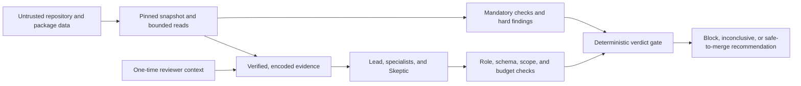

# How Guardian protects its own review

**Design contribution proposed by Rohan Ramesh.** A supply-chain scanner is part of the supply chain it protects. A pull request, dependency archive, registry record, or agent message can supply instructions aimed at the reviewer. Guardian treats its own investigation as a security boundary. The goal is to preserve the right recommendation even if the model misinterprets evidence.

## What is enforced today

- **Run security checks before the model.** The investigation runs D3 for lockfile integrity and origin, D7 for sensitive paths and registry redirects, D0 for advisories, and D4 for lifecycle changes on existing packages. Their status is recorded on the board and in the audit stream. A successful advisory lookup is required for package coverage. Metadata, archives, and failed responses cannot satisfy it. The verdict independently evaluates introduced High/Critical hard findings. Failures, incomplete coverage, or unresolved work prevent a safe recommendation. A run that ends early reports `block` when a mandatory check established a blocker and `inconclusive` otherwise.
- **Keep data separate from actions.** File content, structured metadata, evidence paths, human answers, and inter-agent messages are encoded as untrusted data in model context. Common credential formats are redacted and evidence excerpts are bounded. Literal delimiter characters in inputs are escaped. A small heuristic records reviewer-directed instructions when evidence is rendered. Application code enforces the action boundary even when the heuristic misses an instruction.
- **Validate model requests in the tool dispatcher.** Role allow-lists, JSON schemas, size limits, changed-surface IDs, and task ownership constrain tool calls. Dispatch and handoff use known scopes. A clearance must cite evidence attached to the affected finding. Cases and verdicts are checked before board updates. Shared budgets limit tasks, messages, model turns, and tools. Time limits prevent further work from being scheduled after the deadline.
- **Pin and verify inputs.** Git scanning reads regular tracked blobs at resolved commit IDs. The repository's archive attributes, filters, and symlinks cannot alter that snapshot. Agent HTTP uses explicit destinations, disables redirects, and bounds response size. Tarball reads require supported lockfile integrity digests, and cache entries are checked on each use. Evidence is stored per run and checked against its digest and recorded identity before reuse.
- **Give human answers a narrow purpose.** The dashboard uses a fixed registry-context question with enumerated choices. The run creator receives a review token that is kept out of the model and event stream. The answer is bound to one question and can be accepted only once before expiry. It supplies context and has no power to waive policy or modify repositories.
- **Explain scores locally by default.** Uploaded projects trigger no background model explanations. An operator can set `GUARDIAN_AI_EXPLANATIONS=1` and request an AI summary explicitly. Only the numeric score and allow-listed factor names with numeric contributions are sent. Guardian labels the resulting prose as inferred. Scan errors remain visible and require review when the scanner would otherwise report an allow.

## Threat routes and where to extend the same controls

| Route | Current boundary or planned requirement |
| --- | --- |
| Source, configuration, and diffs | Committed blobs, literal paths, untrusted evidence, credential redaction |
| Filenames, commit metadata, refs, and other identifiers | Resolved commit IDs, changed-surface scopes, separate data fields |
| Dependency archives | Allowed origin, integrity, bounded decompression and member count, static reads |
| Registry metadata | Bounded HTTP and untrusted tool results |
| Advisories and scanner output | Separate check status and evidence, local score explanations |
| Agent messages, handoffs, plans, and history | Typed action checks, encoded narratives, bounded work |
| Human answers | Fixed choices, one-time question ID, expiring run capability |
| Evidence, caches, and replay | Per-run evidence, checked reads, canned replay separated from live facts |
| PR text, comments, issue text, and webhook events | Planned. Verify event identity, pin repository and commit, publish through a separate status identity. |
| Submitted SBOMs, image metadata, and provenance | Planned. Bind the artifact to the reviewed digest and cross-check its claims against independently collected evidence. |
| Fixer inputs and build/test output | Planned. Require approval for the exact patch and commit, then validate with no credentials or outbound network. |
| Persistent case memory and approvals | Planned. Keep prior narratives as evidence and scope approval to its identity, policy version, artifact, and expiry. |

## How to verify it

Run `.venv/bin/python -m pytest -q tests/test_guardian_boundary.py tests/test_agent_loop.py tests/test_constitution.py`.
The tests use local Git repositories, inert reviewer-directed text, fake model turns, and mocked HTTP. They cover detector omission, failed checks, refusal, tool input validation, evidence tampering, safe snapshots, archive integrity, reviewer response binding, and explanation data minimization. The recorded investigation remains a simulated demo.

## Remaining limits

The marker scan and credential redaction are heuristic. Free-form conclusions and rationales still need human review. A passing advisory lookup describes known records for the queried package ID. It does not establish that package code is benign. The investigation's mandatory checks currently cover the npm scenario. Workflow and Dockerfile changes are held for review until the deterministic CI/image checks are wired into the agent verdict gate. Tag drift, default-branch history rewrite, repository authorization, persistent approval identity, and remediation remain separate integration work. The dashboard's run token is a local capability. A shared deployment also needs authentication, per-project access control, and request quotas.

Implementation reference: [tool boundary](../guardian/agents/tools.py), [verdict](../guardian/agents/constitution.py), [agent run](../guardian/agents/run.py), [Git snapshot](../guardian/git_snapshot.py), and [local explanation](../guardian/scoring/explain.py).
